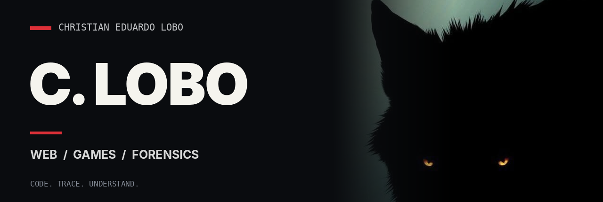

  

### about

I'm Christian. I build web interfaces, work with game code, and investigate digital traces.

**HTML & CSS** are my strongest tools. I know the basics of **JavaScript**, and I'm working on getting better at **C++**. I also have experience investigating cheats in **FiveM**, Windows logs, execution artifacts and steganography.

### forensic desk

| System inspection | Artifacts & timelines |
|:--|:--|
| [Process Explorer](https://learn.microsoft.com/en-us/sysinternals/downloads/process-explorer) | [MFTECmd](https://github.com/EricZimmerman/MFTECmd) |
| [Process Monitor](https://learn.microsoft.com/en-us/sysinternals/downloads/procmon) | [AmcacheParser](https://github.com/EricZimmerman/AmcacheParser) |
| [Sigcheck](https://learn.microsoft.com/en-us/sysinternals/downloads/sigcheck) | [Timeline Explorer](https://ericzimmerman.github.io/) |
| [Event Viewer](https://learn.microsoft.com/en-us/shows/inside/event-viewer) | Windows Prefetch / USN Journal |
| Registry Editor | NTFS / $MFT / Event Logs |

### stack

  

### currently

Learning more C++ by reading, debugging and writing code. Exploring Windows internals and building tools worth publishing.

---

**C. LOBO** · Brazil · [repositories](https://github.com/christianeduardolobo?tab=repositories)
