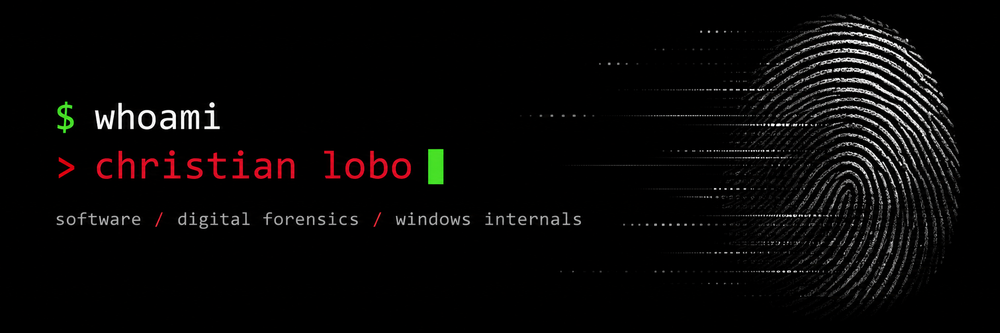

<p align="center">
  
</p>

## `01` / About

I'm Christian Eduardo Lobo, from Brazil. I work on software projects and study Windows internals, software security and digital forensics.

My interest is in both sides of software: building it and understanding what happens when it runs. I study process behavior, memory, authentication and the artifacts applications leave on a system.

## `02` / Technical focus

**Software & systems**

C++ · Win32 API · process memory · debugging · client/server architecture

**Digital forensics**

NTFS / $MFT · USN Journal · Prefetch · Amcache · Windows Event Logs · timeline reconstruction

**Security**

Software integrity · authentication · reverse engineering · anti-cheat analysis

## `03` / Toolkit

```text
Development    C++ / Python / JavaScript / HTML / CSS
Environment    Windows / VS Code / Git
Inspection     Process Explorer / Process Monitor / Sigcheck
Forensics      MFTECmd / AmcacheParser / Timeline Explorer
```

## `04` / Current work

- Developing and debugging native Windows applications.
- Exploring authentication, software integrity and process internals.
- Practicing Windows artifact analysis and forensic reconstruction.

---

<sub>Brazil &nbsp; / &nbsp; <a href="https://github.com/christianeduardolobo?tab=repositories">Repositories</a></sub>
