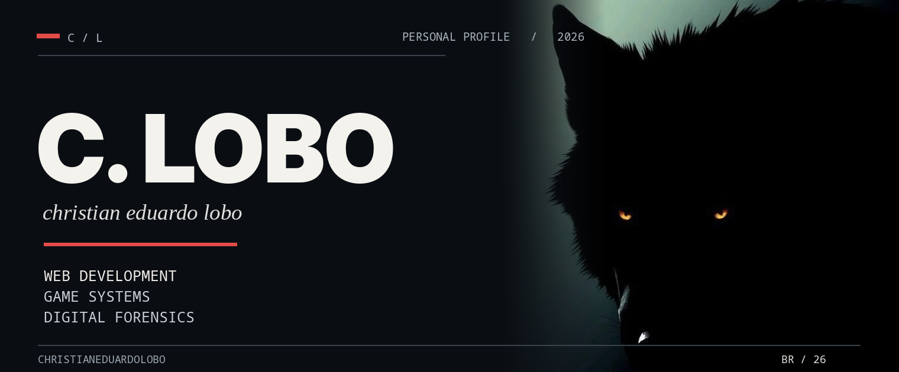
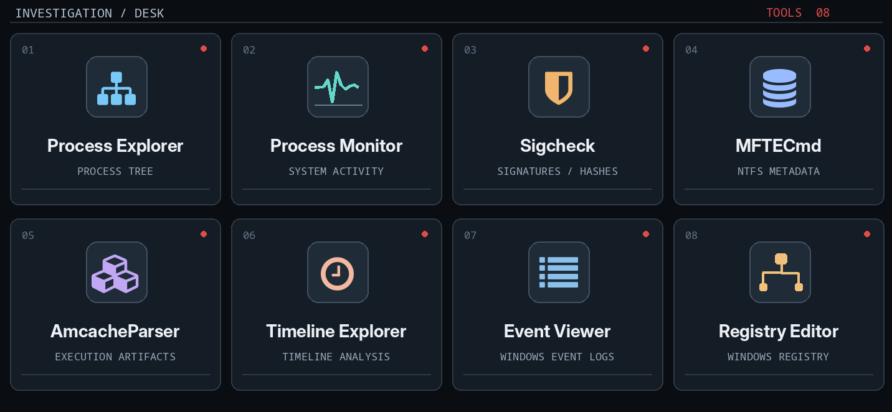
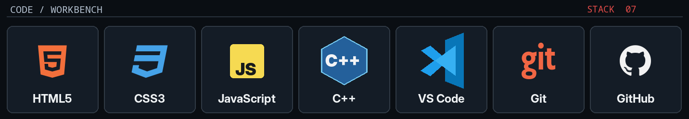
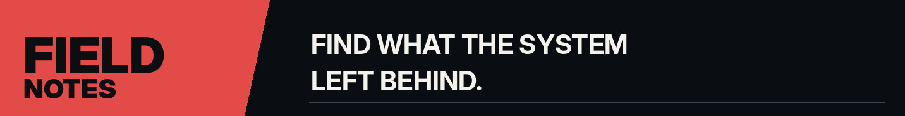

 

**WEB DEVELOPMENT** &nbsp; / &nbsp; **GAME SYSTEMS** &nbsp; / &nbsp; **DIGITAL FORENSICS**

 

### 01 &nbsp; / &nbsp; ABOUT

I'm Christian. I work with **web interfaces**, **game-related code** and **digital investigations**. I like getting past the surface of a system and figuring out what's actually happening underneath.

I know my way around **HTML and CSS**, have a foundation in **JavaScript**, and I'm getting deeper into **C++**. I've also worked with **FiveM cheat screening**, Windows artifacts, logs and execution traces.

Steganography, game security and digital forensics are the areas I keep coming back to. **Memory analysis is something I still want to learn**, not a skill I'm claiming yet.

 

### 02 &nbsp; / &nbsp; FORENSIC DESK

Things I investigate: Prefetch &nbsp;·&nbsp; Amcache &nbsp;·&nbsp; NTFS / $MFT &nbsp;·&nbsp; USN Journal &nbsp;·&nbsp; Event Logs &nbsp;·&nbsp; Registry

 
 

### 03 &nbsp; / &nbsp; DEVELOPMENT

**Strongest in:** HTML / CSS &nbsp; · &nbsp; **Working on:** C++ &nbsp; · &nbsp; **Foundation:** JavaScript

 

### 04 &nbsp; / &nbsp; CURRENTLY

- **Building** web interfaces and game-related tools.
- **Investigating** Windows artifacts, software traces and suspicious behavior.
- **Learning** more C++ by reading, debugging and writing code myself.

My public repositories are still taking shape. I won't pin fake projects just to fill the page.

---

[**GITHUB**](https://github.com/christianeduardolobo) &nbsp;&nbsp; / &nbsp;&nbsp; [**REPOSITORIES**](https://github.com/christianeduardolobo?tab=repositories)

C. LOBO &nbsp;—&nbsp; code / trace / investigate

