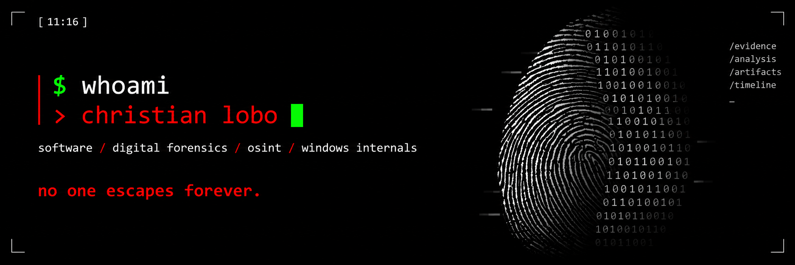

<p align="center">
  
</p>

## `01` / About

I'm Christian Eduardo Lobo, a developer from Brazil with an interest in digital forensics, software security and Windows internals.

I build software and study the traces it leaves behind. My interests range from native applications and process behavior to digital evidence, authentication and forensic reconstruction.

## `02` / Technical Focus

**Software & Systems**  
C++ · Win32 API · Process Memory · Debugging · Client/Server Architecture

**Digital Forensics & OSINT**  
NTFS · $MFT · USN Journal · Prefetch · Amcache · Windows Event Logs · Timeline Reconstruction · Open-Source Intelligence

**Software Security**  
Authentication · Software Integrity · Reverse Engineering · Anti-Cheat Analysis

## `03` / Technical Toolkit

```text
Development    C++ / Python / JavaScript / HTML / CSS
Environment    Windows / VS Code / Git
Inspection     Process Explorer / Process Monitor / Sigcheck
Forensics      MFTECmd / AmcacheParser / Timeline Explorer
```

## `04` / Current Focus

- Developing and debugging native Windows applications.
- Studying process behavior, memory and operating system internals.
- Examining authentication mechanisms and software integrity.
- Reconstructing events through Windows forensic artifacts and open-source research.

---

<p align="center">
  <sub>
    Brazil &nbsp; / &nbsp;
    <a href="https://github.com/christianeduardolobo?tab=repositories">Repositories</a>
    &nbsp; / &nbsp; EOF_
  </sub>
</p>
